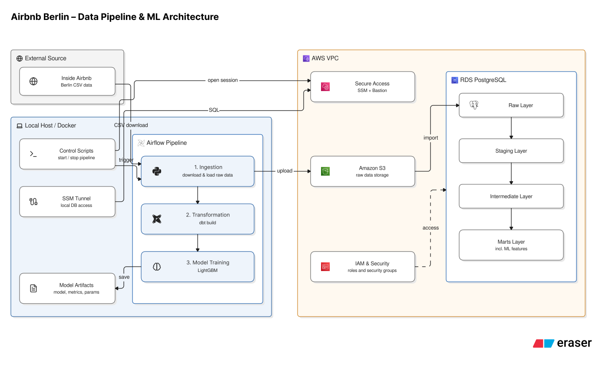

# Airbnb Berlin dbt project

This project presents an automated pipeline which scrapes the Airbnb Berlin listings and review data from the insideairbnb.com website every three months (when new data gets published), stores it either locally or in the cloud, transforms it with dbt and finally trains a ML-model on the aggregated data by month to predict review activity for the following months. The project uses Python, dbt, Docker, Airflow and Terraform to achieve this. What makes the dataset an intriguing choice to work with is that it represents real world data with common problems associated with it: inconsistent metadata, schema drift and missingness, which pose an interesting challenge during the necessary cleansing and preparation. 

## Setup

The AWS CLI needs a profile named `terraform`:

```bash
aws configure --profile terraform
```

Create an `.env` file in the project root and fill it with the `.env.example` variable credentials. Terraform reads it too.

`DB_HOST` and `DB_PORT` point at the local end of the SSM tunnel, as the database has no public endpoint.

For the AWS infrastructure, run:

```bash
cd terraform
terraform init
terraform apply
```

This creates a VPC with private subnets, the RDS instance, an S3 bucket, a
`t4g.nano` bastion reachable only through SSM, and the IAM roles. Creating
RDS will probably take a few minutes.

Then make the scripts executable:

```bash
cd ..
chmod +x start_pipeline.sh stop_pipeline.sh
```

In the beginning a one-time database setup is required: the S3 import extension has to be enabled once. To do this, open the tunnel first:

```bash
set -a; source .env; set +a
BASTION_ID=$(terraform -chdir=terraform output -raw bastion_id)
RDS_HOST=$(terraform -chdir=terraform output -raw rds_address)

aws ssm start-session --target "$BASTION_ID" \
  --document-name AWS-StartPortForwardingSessionToRemoteHost \
  --parameters "host=$RDS_HOST,portNumber=5432,localPortNumber=$DB_PORT"
```

Then, in a second terminal:

```bash
set -a; source .env; set +a
PGPASSWORD="$DB_PASSWORD" psql -h localhost -p "$DB_PORT" -U "$DB_USER" \
  -d "$DB_NAME" -c 'CREATE EXTENSION IF NOT EXISTS aws_s3 CASCADE;'
```

You can close the tunnel with Ctrl+C afterwards. To run dbt and ML locally without AWS, set `PIPELINE_TARGET=local`, point `DB_HOST`/`DB_PORT` at a local Postgres and skip AWS infrastructure setup. Raw files are then stored on disk instead of S3, and `COPY FROM STDIN` replaces the S3 import.


## Running the pipeline

`start_pipeline.sh` does everything: it boots the bastion, opens the SSM
tunnel, starts Airflow, triggers the DAG, waits for it to finish and then
calls `stop_pipeline.sh`, which tears down the container, the tunnel and
the bastion.

```bash
./start_pipeline.sh
```

The DAG runs three tasks in order: ingestion, `dbt build`, model training.
The ingestion task exits non-zero when no new cohort is available, so
Airflow retries it up to three times a week apart as the project publishes the data irregularly within the quarter.

*Note about schema drift:* Inside Airbnb keeps only the four most recent scrapes online, so cohort 25.09.23 — which this project was built on — has since dropped off the website. A fresh clone therefore starts with four cohorts instead of five, and the columns that existed only in that first scrape (`host_since`, `host_response_time`, `host_acceptance_rate`, `instant_bookable`) never appear at all. The data contract reports this as schema drift on the first load, which is the intended behaviour. The ML model, however, already excludes these columns, so results stay comparable.

For the pipeline to automatically start every three months and not have a container up and running empty for the whole time frame, one can schedule it with cron, under linux/macOS with `crontab -e`: 
```
0 9 1 1,4,7,10 * /path/to/project/start_pipeline.sh. 
```
On Windows use the Task Scheduler.

To inspect things by hand:

```bash
# Airflow UI, while the container is up
http://localhost:8080

# model dependency lineage and documentation
docker compose -f docker/compose.yaml exec -w /opt/airflow/project/dbt pipeline \
  /opt/airflow/dbt-venv/bin/dbt docs generate
docker compose -f docker/compose.yaml exec -w /opt/airflow/project/dbt pipeline \
  /opt/airflow/dbt-venv/bin/dbt docs serve --port 8081
```

## Architecture



Quarterly, one cohort at a time: 

1. the Ingestion task downloads new listing and review files, streams them to S3 
    or the local data/ directory and loads them into `airbnb_raw_data` via `aws_s3.table_import_from_s3` or via the Postgres `COPY` command. A data contract in YAML detects schema drift before anything is written.
2. dbt types and cleans the raw text columns (staging), applies the
   business logic once across all cohorts (intermediate) and builds the
   dimensions, facts and the ML feature table (marts).
3. During training a LightGBM model is fit on the monthly feature table and only
   saves it if it beats the previous months baseline. Otherwise it is recommended to finetune the model (manual step), a sample script is provided.

## Design decisions

### Database related

**A database instead of seeds:** In this setup I have chosen a separate database instead of dbt seeds because of the massive volume of the datasets. Even though official metadata exists it is incomplete, so the column contract lives in the project and is checked on every load.

**SSM Session Manager for database access.** The RDS instance has no public endpoint and no inbound security group rule; access goes through a port forward over the bastion. EC2 Instance Connect Endpoint was the alternative but has a 1h session limit. For a more realistic production setup in the future one could perhaps go for a low-config peer-to-peer VPN solution, which would be more initial setup but afterwards more comfortable because one would not need start an ssm session every time before querying.

### Pipeline related

**Airflow locally, data in AWS**: This hybrid setup assumes the mart layer is
queried in day to day business operations e.g. by analysts, which is what keeps RDS around. For model retraining alone, a cloud-native setup would be cheaper and simpler —  e.g. Step Functions with a self-terminating ECS Fargate task could replace Airflow entirely.

**Orchestration the DAG trigger by shell script, not by Airflow itself.** A shell script is responsible for booting the stack and tearing everything down afterwards. I have gone for this design to keep things a little bit more realistic: with only four DAG runs a year it would be a waste of resources to keep the container up and running all the time. Airflow shutting itself down would likely be fragile. The price of the simpler route is one script that stays open until the DAG finishes, which can be weeks if no new data appears. Outside those windows the machine has no open path into AWS.

### ML related

**Review activity as the target.** Booking data is not public, and
availability is ambiguous because blocked can mean booked or withheld by the
host or available only under specific conditions e.g. long term stay. Review counts seem to be the better proxy, and unlike price they have no
gaps and one consistent definition across cohorts. The target is a count
with about 70 percent zeros, so the model trains on a Poisson objective and
is judged on Poisson deviance.

**Walk-forward evaluation.** The newest cohort is scored once as test
before it is ever used for tuning or training; on the next run it becomes
validation and later training data, so no cohort is evaluated twice.

**Tuning is manual, retraining is automatic.** Training runs with fixed
parameters on every new cohort and refuses to save a model that loses to
the baseline. Hyperparameter search is a separate script, started by hand
after the failure mail — tuning on every run would cost hours and make
consecutive runs incomparable.

## Future steps

* finetune ML with more hyperparameter and an adaptive search algorithm.
* Move training to the cloud, e.g. via
  `airflow.providers.amazon.aws.operators.sagemaker`.
* Monitor feature drift across cohorts — not meaningful yet with five of them.
* It would be cool to have an agentic layer (LangGraph) for Airflow failures: to classify the failure, then open a pull request with a proposed fix, such as an updated source URL, for a human to review.

If the mart layer were really queried by an analytics team:

* Replace SSM Session Manager with Tailscale or another VPN mesh network solution